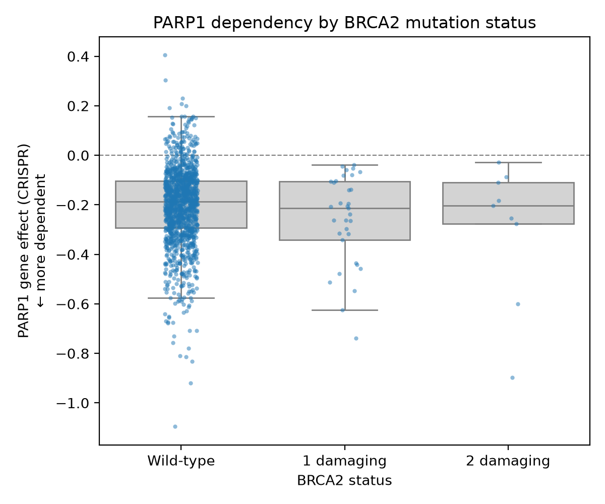
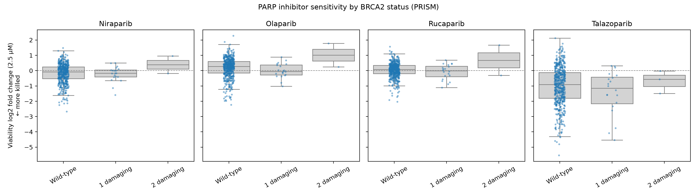

# BRCA2 loss and PARP inhibitor sensitivity

**Question:** Are BRCA2-mutant cancer cell lines more dependent on PARP1, and more sensitive to PARP inhibitors, than BRCA2 wild-type lines?

Synthetic lethality between BRCA2 loss and PARP inhibition is the basis for drugs like olaparib in BRCA-mutant breast, ovarian, prostate and pancreatic cancers. This project tests how clearly that relationship shows up across hundreds of cancer cell lines in public data from the Cancer Dependency Map (DepMap), using both genetic knockout (CRISPR) and drug response (PRISM).

## Key findings

1. **Knocking out PARP1 does not selectively kill BRCA2-mutant cells.** PARP1 dependency was similar in BRCA2-mutant and wild-type lines.
2. **PARP inhibitor drugs show at most a weak BRCA2 signal across cancers.** Olaparib showed a nominal trend in lines with one damaging BRCA2 mutation (p = 0.03), which does not survive correction for multiple testing.
3. **The data behave as the biology predicts in other ways:** talazoparib, the most potent PARP trapper, killed cells far more strongly than the other three inhibitors regardless of BRCA2 status.

The main limitation is sample size: only 2–3 cell lines with two damaging BRCA2 mutations (the group most likely to be truly BRCA2-deficient) were screened with these drugs.

## Data

| Source | Files | What it gives |
|---|---|---|
| DepMap Public 26Q3 | `Model.csv` | Cell line annotations |
| | `OmicsSomaticMutationsMatrixDamaging.csv` | Damaging mutations per gene per cell line |
| | `CRISPRGeneEffect.csv` | Gene knockout effect (Chronos score) |
| PRISM Repurposing Public 24Q2 | `Repurposing_Public_24Q2_Extended_Primary_Data_Matrix.csv` | Viability (log2 fold change) after 6,790 drug treatments at 2.5 µM |
| | `Repurposing_Public_24Q2_Extended_Primary_Compound_List.csv` | Drug names, targets and mechanisms |

Data files are not stored in this repo. Download them from the [DepMap portal](https://depmap.org/portal/data_page/?tab=allData) into `data/raw/`.

## Methods

- **BRCA2 status:** one default sequencing entry per cell line (2,395 lines). Lines were grouped by the number of damaging BRCA2 mutations: wild-type (2,320), 1 damaging (63) or 2 damaging (12). Two hits are more likely to mean real loss of BRCA2 function; a single hit in this very large gene is often a passenger or heterozygous.
- **Comparisons:** each mutant group vs wild-type, using a one-sided Mann–Whitney U test (no assumption of normality), asking whether mutant lines are *more* dependent or *more* sensitive.

## Results

### 1. PARP1 CRISPR dependency

1,361 cell lines had both mutation and CRISPR data.

| BRCA2 status | n | Median PARP1 effect | p vs wild-type |
|---|---|---|---|
| Wild-type | 1,319 | −0.188 | – |
| 1 damaging | 33 | −0.214 | 0.096 |
| 2 damaging | 9 | −0.203 | 0.30 |



**Interpretation:** PARP inhibitors kill BRCA-deficient cells mainly by *trapping* PARP1 on DNA, creating lesions those cells cannot repair. Removing PARP1 entirely does not create trapped complexes, and PARP1 loss is a known route to PARP-inhibitor resistance. A null result here is therefore expected, and it is why drug-response data are needed.

### 2. PARP inhibitor sensitivity (PRISM, 2.5 µM)

919 cell lines were screened. Four PARP inhibitors were in the screen. Lower values mean more cells killed.

| Drug | BRCA2 group | n | Median (mutant vs WT) | p |
|---|---|---|---|---|
| Olaparib | 1 damaging | 20 | −0.05 vs 0.28 | **0.03** |
| Olaparib | 2 damaging | 2 | 1.01 vs 0.28 | 0.86 |
| Talazoparib | 1 damaging | 20 | −1.14 vs −0.90 | 0.13 |
| Talazoparib | 2 damaging | 3 | −0.57 vs −0.90 | 0.65 |
| Niraparib | 1 damaging | 20 | −0.17 vs −0.08 | 0.29 |
| Niraparib | 2 damaging | 2 | 0.39 vs −0.08 | 0.83 |
| Rucaparib | 1 damaging | 20 | −0.01 vs 0.07 | 0.19 |
| Rucaparib | 2 damaging | 2 | 0.68 vs 0.07 | 0.68 |



**Interpretation:** across eight tests, only olaparib in single-hit lines reached p < 0.05. That would not survive a Bonferroni correction (threshold ≈ 0.006), so it is a trend rather than a finding. The biallelic groups are too small to interpret.

## Limitations

- Very few truly BRCA2-deficient cell lines have drug data (2–3 per drug).
- "Damaging mutation" does not confirm loss of function: copy-number loss, loss of heterozygosity and promoter methylation are not yet considered.
- The PRISM primary screen uses one dose (2.5 µM) and is noisier than full dose-response data.
- The analysis is pan-cancer, so lineage differences may mask BRCA2 effects.

## Next steps

- Define BRCA deficiency more rigorously: biallelic loss using copy-number data, and include BRCA1 and other homologous-recombination genes.
- Use dose-response data (PRISM secondary screen, GDSC) and compare AUC values instead of a single dose.
- Control for cancer lineage, for example with a regression model including lineage as a covariate.
- Search genome-wide for genes that BRCA2-mutant lines specifically depend on (new synthetic-lethal partners).

## Reproduce

```bash
conda env create -f environment.yml
conda activate brca2
jupyter lab   # then run notebooks/01_explore_data.ipynb
```

## Repository structure

```
├── data/raw/            # DepMap + PRISM downloads (not tracked)
├── notebooks/           # analysis notebooks
├── results/figures/     # saved figures
├── src/                 # reusable code (coming)
└── environment.yml      # conda environment
```

## References

- DepMap, Broad Institute. DepMap Public 26Q3. https://depmap.org
- Corsello SM et al. (2020). Discovering the anticancer potential of non-oncology drugs by systematic viability profiling. *Nature Cancer* 1, 235–248.

*Analysis by Prithviraj Dasgupta. All analysis decisions and interpretation reviewed by the author.*
